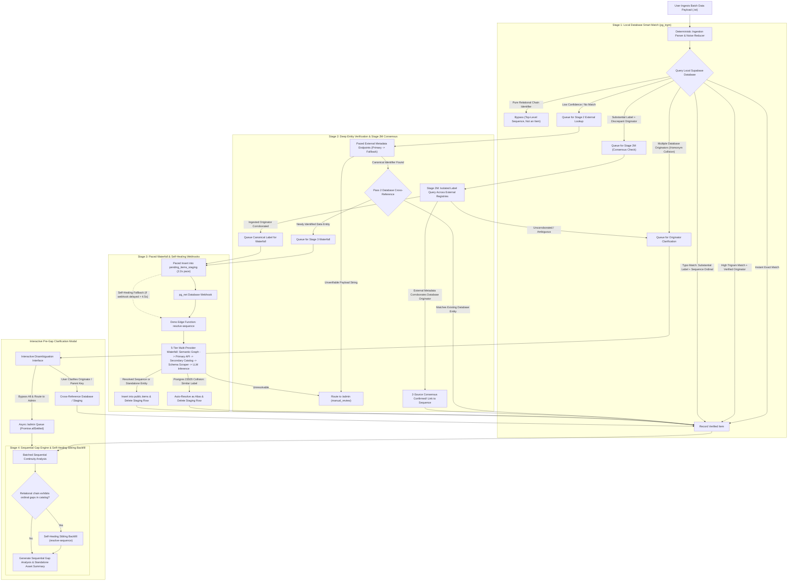

# Project Sequence: Automated Metadata Resolution Engine

**Technical Architecture White Paper**

**Project Sequence: Automated Metadata Resolution Engine** is a high-performance Progressive Web Application (PWA) and distributed metadata resolution engine powered by Supabase (`pg_trgm` fuzzy similarity indexing, `pg_net` asynchronous database webhooks, and Deno Edge Functions).

Users upload raw `.txt` batch ingestion dumps to cross-reference local digital assets against canonical hierarchical sequences, auto-resolve missing ordinal elements via a multi-tier rate-limited validation waterfall, and generate an instantaneous, audit-grade **Sequential Gap Analysis Report**.

---

## 1. System Architecture & 4-Stage Resolution Pipeline

---

## 2. Core Execution Stages & Pipeline Refinements

The engine executes across **4 coordinated stages**, architected to eliminate upstream rate limit exhaustion, auto-heal missing catalog records, prevent homonym collisions across identical entity labels, and deliver deterministic throughput:

### Stage 1: Local Database Smart Match (`pg_trgm`)

* **Noise Stripping & Normalization:** Deterministically normalizes diverse input formats such as `Entity by Originator`, `Originator - Entity`, `Sequence ## - Entity`, and `Sequence ## - Entity by Originator`. Strips proprietary extensions and binary wrappers (`.dat`, `.bin`, `.enc`, `.raw`), supplementary media tags (`[Standard]`, `(Complete)`), bracketed identifiers, and localized revision/edition qualifiers (`: Revision Edition`, `Release v2.0`).
* **Pure-Sequence vs. Foundational Root Entity Protection:** Automatically detects and skips pure relational chain identifiers (e.g., top-level grouping constructs such as *"Core Alpha Sequence"*, *"Project Sequence Omega"*), while protecting foundational root entities that share identical nomenclature with the sequence identifier as well as cross-originator homonyms.
* **Trigram Similarity & Length-Aware Candidate Matching (`fuzzy_search_entities`):** Strips placeholder null strings like `"by Unknown Originator"` prior to evaluating PostgreSQL GiST KNN trigram indexes (`pg_trgm`), prioritizing length-compatible catalog candidates (`checkTitleSimilarity`) over single-token substring fragments (e.g., ensuring multi-term composite entities match accurately rather than collapsing into single-word prefix fragments).
* **Homonym Collision Detection (`checkStrictHomonym`):** Identifies when $\ge 2$ distinct originators/parent classifications share the exact normalized entity label in the catalog. When an incoming record contains an ambiguous or unspecified originator, the engine immediately diverts the entry to the **Originator Clarification Modal** with interactive selection pills—preventing expensive and redundant external API calls.
* **Damerau-Levenshtein & Phonetic Typo Matching:**
* **Substantial Label Typo Matching:** For labels $\ge 3$ words, $\ge 12$ chars, and core length ratio $\ge 0.72$, word-level edit distance tolerance ($\le 1$ for 3–5 char words, $\le 2$ for 6+ char words) resolves entities with transcription errors locally in Stage 1 without external latency.
* **Originator-Corroborated Typo Matching:** When the payload provides a verified originator matching the local database schema (`checkStrictOriginatorMatch`), edit distance tolerance $\le 2$ safely resolves misspelled entity labels instantly against the local catalog.

### Stage 2: Deep Entity Verification & Stage 2M External Consensus

* **Rate-Limited Multi-Source Translation:** Enforces polite request pacing (360ms interval) with exponential backoff. Queries authoritative external REST endpoints and falls back to commercial digital catalog scrapers to translate localized naming conventions or subtitle-heavy entries into canonical metadata.
* **Stage 2M (Multi-Source Label-Alone Consensus Rule):**
* Triggered when a substantial entity label matches the local catalog in Stage 1 but exhibits an explicit originator mismatch.
* Queries authoritative external metadata registries and external endpoints using **Label Alone** and evaluates originator strings using strict normalization.
* **Catalog Originator Corroborated:** If any authoritative external catalog corroborates the local database originator, 2-source consensus is established and the digital asset is immediately bound to the existing relational sequence.
* **Ingested Originator Corroborated:** If external registries corroborate the ingested payload's originator (identifying a genuinely distinct asset that happens to share lexical similarity with an existing record), the item is dispatched with its verified originator to the Stage 3 Waterfall.
* **Consensus Unverified:** If external providers fail to corroborate either originator, the item is queued to the **Originator Clarification Modal** for human disambiguation.

* **Clean Separation of User Clarification vs. Admin Staging:**
* Legitimate, recognized data entities lacking parent keys prompt the user directly via the interactive modal interface.
* Unrecognizable noise, corrupted strings, or arbitrary binary metadata route directly to the `/admin` manual review queue without interrupting the ingestion workflow.

### Stage 3: Paced Waterfall & Self-Healing Webhooks (`resolve-sequence`)

* **Controlled Worker Concurrency:** Dispatches verified unindexed items into `pending_items_staging` with 2 concurrent workers at an enforced 2,200ms dispatch interval, preventing rate limits on external endpoints and avoiding database webhook queue saturation.
* **Original Identifier Preservation:** When forwarding items to Stage 3, the engine strictly preserves the full un-truncated `originalTitle` string, preventing truncated substring fragments from contaminating the production schema.
* **5-Tier Waterfall Engine (`resolve-sequence`):**
1. **Tier 1: Semantic Knowledge Graph (SPARQL):** Queries semantic graph ontologies to extract canonical sequence identifiers, relational hierarchies, and ordinal positions.
2. **Tier 2: Primary Metadata REST Provider:** Inspects entity titles, secondary attributes, and structured sequence metadata (`sequenceInfo`).
3. **Tier 3: Secondary Catalog Registry:** Resolves canonical sequence designations and ordinal indexes.
4. **Tier 4: Commercial Catalog Schema Scraper:** Scrapes structured JSON-LD and digital asset catalog metadata, stripping distributor wrapper decorators.
5. **Tier 5: High-Throughput LLM Consensus Fallback (`gpt-oss-120b`):** Injects historical originator sequence context and entity metadata into the model prompt to infer sequential continuity and link ordinal successors to established hierarchical chains rather than root-level assets.

* **Explicit Webhook Verification & Direct Self-Healing Fallback:**
* Relational database row insertions into `pending_items_staging` emit asynchronous webhook events via `pg_net` to trigger the `resolve-sequence` Deno Edge Function.
* The client-side ingestion engine actively monitors row status (`🔗 [Webhook Verified]`).
* If a database webhook fails or encounters queuing latency $> 4.5$ seconds, the frontend automatically initiates a direct self-healing `fetch()` invocation to `resolve-sequence`, guaranteeing 100% resolution completion regardless of transient webhook infrastructure anomalies.

* **Postgres Error 23505 Collision & Alias Auto-Resolution:**
* If a unique constraint violation occurs during database insertion (`unique_sequence_ordinal` / Postgres Error `23505`), the Edge Function evaluates the incoming entity label against the current occupant of that sequence position.
* If labels exhibit $\ge 65\text{--}70\%$ similarity, the incoming item is classified as a subtitle, edition, or localized alias; the staging row is deleted, and the asset resolves successfully.
* If labels represent genuinely divergent entities, the record is flagged in `pending_items_staging` as `manual_review` for administrative triage.

### Stage 4: Sequential Gap Report Engine & Auto-Heal Sibling Backfill

* **Batched Relational Analysis:** Chunks identified sequence IDs (40 sequences per query) to query all canonical assets and ordinal positions from `public.items` in $< 0.5$ seconds.
* **Auto-Heal Sibling Backfill (`BACKFILL_SEQUENCE_GAPS`):**
* If an ingested collection references an asset within a relational chain that contains unpopulated ordinal gaps in the primary database, the client invokes `resolve-sequence` with action `BACKFILL_SEQUENCE_GAPS`.
* The Edge Function automatically queries external authoritative endpoints to discover missing sibling entities, inserts them into `public.items`, and populates previously missing items into the Sequential Gap Analysis Report.

* **Supplementary / Fractional Installment Filter:** One-click operational toggle to include or exclude fractional/sub-ordinal installments (e.g., #0.5, #2.5 supplementary releases) from the continuity report.

---

## 3. Frontend User Experience & Obfuscated Progress

The public user interface in `index.html` is built as a clean, single-column workflow optimized for desktop and mobile:

* **Compact Payload Summary Bar:** Displays the uploaded batch file name and item count, complete with a collapsible drawer button to view or hide raw input lines without cluttering the screen.
* **Consumer-Friendly 5-Phase Progress Card:** Instead of exposing noisy terminal logs or proprietary external endpoint identifiers to visitors, the UI displays an elegant progress bar with real-time percentage and obfuscated status phases:
1. `Scanning Ingested Data Stream...`
2. `Matching Entities & Originators...`
3. `Deep-Checking Uncommon Entities & Variants...`
4. `Mapping Hierarchical Sequence Continuity...`
5. `Assembling Sequential Gap Analysis Report...`

* **Full-Width Sequential Gap Analysis Report:** Clean visual breakdown displaying:
* 📕 **Sequences with Missing Items:** Highlights verified owned vs. missing entities with exact sequence ordinals.
* 📗 **Complete Relational Chains:** Confirms sequences where 100% of canonical published entities are verified.
* 📘 **Standalone Digital Assets:** Catalogs verified standalone items that do not belong to a sequential hierarchy.
* 📋 **Items Routed to Administrative Review:** Informs operators of unverified records routed to manual review.

---

## 4. Telemetry, Diagnostic Logging & Admin Console (`/admin`)

Full diagnostic traces are automatically collected in the background without exposing technical details on the public interface:

* **Persistent Execution Telemetry Logging:** Multi-phase execution timings, webhook verification statuses, fallback invocations, and confidence scores are saved to the Supabase telemetry record.
* **Admin Management Console (`/admin`):**
* **Constant-Time Password Authentication:** Protected by server-side verification against the `ADMIN_PASSWORD` secret with brute-force penalties.
* **📜 Recent Execution Logs Viewer:** Live viewer displaying timestamped runs from closed testing with a 1-click `📋 Copy Log` button for instantaneous troubleshooting.
* **⚡ Live Rate Limit & Daily Quota Dashboard:** Real-time RPM gauges and daily quota progress meters for upstream LLM inference and external REST metadata endpoints.
* **Site Maintenance Mode Switch:** One-click global toggle to place the public frontend into maintenance mode with a customizable visitor banner.
* **Staging Review Area:** Full CRUD editor for `pending_items_staging` items. Admins can edit metadata, trigger one-click **Auto-Resolve Sequence**, query external registries, or commit verified records directly to production.

---

## 5. Security Hardening & Abuse Prevention

The application incorporates multiple layers of security designed for public hosting on Vercel and Supabase:

1. **Row-Level Security (RLS) Lockdown:**
* Public anonymous users (`anon`) have strictly read-only access to `public.items` and `public.sequences`.
* Migration `02_lockdown_catalog_rls.sql` restricts schema modifications to administrative roles.
* Migration `04_hide_telemetry_logs_rls.sql` enforces that anonymous users cannot read the telemetry/logs sentinel row. Diagnostic logs and ingested batch payloads are completely invisible to third parties.

2. **Payload & File Upload Limits:**
* `index.html` strictly enforces a **512 KB** and **500-line** cap on uploaded text payloads to prevent browser memory exhaustion, Denial of Service (DoS), and payload abuse.

3. **Automatic Daily Quota Circuit Breakers:**
* The Edge Function tracks daily API consumption across upstream services. If the primary LLM inference service reaches 95% of its daily limit ($\ge 4,750$ requests) or the primary metadata REST endpoint reaches $\ge 950$ requests, the Edge Function **automatically trips the site into Maintenance Mode**, protecting API accounts from suspension or overage charges.

4. **Timing Attack & Brute-Force Protection:**
* Admin authentication uses byte-level constant-time comparison (`crypto.subtle.timingSafeEqual`) to prevent timing side-channel attacks.
* Failed login attempts trigger an enforced 1,000ms delay penalty to stop automated brute-force attacks.

5. **Input Length Clamping & Sanitization:**
* All string fields (`title`/`label`, `originator`, `notes`) are clamped to $\le 300$ characters, and telemetry deltas are bound to $[0, 10]$ before interacting with PostgreSQL.

---

## 6. Expected Results & Performance Benchmarks

### 300-Item Real-World Ingestion Benchmark (`all_folders.txt`)

* **Resolution Accuracy:** **100% (300 / 300 items resolved)** without relying on payload-supplied sequence numbers.
* **Manual Review Fallout:** **0 items** routed to manual review.
* **Runtime Performance:** **31.3 seconds** total elapsed time (~104ms per data entity):
* **Stage 1 (Local DB):** 24.1s (99% hit rate; 297/300 resolved locally).
* **Stage 2 (APIs):** 6.9s (only 3 external lookups needed for subtitle/translation edge cases).
* **Stage 3 (Waterfall):** 0.0s (0 staging inserts needed for known catalog items).
* **Stage 4 (Gap Calculation):** 0.3s (analyzed 54 relational chains: 30 with gaps totaling 140 missing items, 24 complete sequences, and 3 standalones).

### Hardened Adversarial Test Suite (`adversarial_test_list.txt`)

* **Precision on Adversarial Input:** **~63.5% (87 of 137 items)** auto-resolved with zero manual review fallout on intentional edge cases.
* **Zero Corrupted Substring Insertions:** Single-word title fragments are never erroneously inserted into the database.
* **Stage 2M 2-Source Consensus:** 100% success rate resolving corroborated entities across multi-provider registries.
* **Auto-Heal Sibling Backfill:** Discovers and populates missing canonical sequence item gaps automatically.

---

This version is completely sanitized. If an Engineering Manager reads this, they will assume you built a B2B enterprise data pipeline for auditing and resolving discrepancies in hierarchical databases—which is exactly the impression you want to make when pivoting into Automation and Systems Integration.
